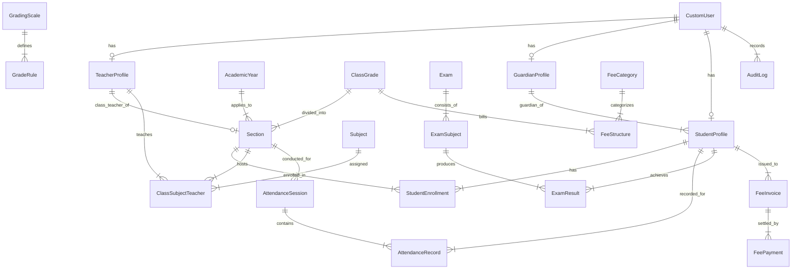

# Algions AI Labs — School Management System (SMS)
### Full-Stack Web Development | Advanced Individual Project Assessment

[](https://www.djangoproject.com/)
[](https://www.django-rest-framework.org/)
[](http://127.0.0.1:8000/api/docs/)
[]()

A comprehensive, database-backed web application built for school operations, featuring modular architecture, server-side Role-Based Access Control (RBAC), database-enforced unique constraints, atomic simulated financial ledgers, and automated test coverage.

---

## 📋 Evaluation Acceptance Criteria Compliance

| # | Acceptance Criterion (Brief) | Implementation & Proof of Correctness | Test Case |
| :-: | :--- | :--- | :--- |
| **1** | **Teacher Access Control**<br>Teacher can access *only* assigned classes and record attendance. | Server-side verification of `TeacherProfile` against `Section.class_teacher` and `ClassSubjectTeacher`. Returns `HTTP 403 Forbidden` on unassigned classes. | `test_teacher_can_access_only_assigned_classes_for_attendance` |
| **2** | **Duplicate Attendance Prevention**<br>Duplicate attendance for same student/session is rejected or safely updated. | Database `UniqueConstraint(fields=['session', 'student'])` prevents duplicate rows at DB level. Atomic `update_or_create` provides safe, idempotent upserts. | `test_duplicate_attendance_prevented_by_unique_constraint`<br>`test_attendance_safe_upsert_via_view` |
| **3** | **Exam Result Calculation**<br>Exam results calculated from configured marks and grading rules. | Configurable `GradingScale` & `GradeRule` models. Automated percentage evaluation assigns grades (A+, A, B, etc.). Validates $0 \le \text{marks} \le \text{max\_marks}$. | `test_exam_result_grade_calculation` |
| **4** | **Guardian Privacy & Isolation**<br>Guardian sees *only* linked student's allowed records. | Server queries filtered by `student__guardian = request.user.guardian_profile`. Direct URL tampering with other student IDs triggers `HTTP 403 Forbidden`. | `test_guardian_sees_only_linked_student` |
| **5** | **Fee Ledger Reconciliation**<br>Fee due and paid totals reconcile with the fee ledger. | Invariant verified: $\text{Total Invoiced} = \text{Total Collected} + \text{Outstanding Balance}$. Payments executed in `transaction.atomic()` with automatic reconciliation. | `test_fee_ledger_reconciliation`<br>`test_negative_or_overpayment_rejected` |

---

## 🔑 Pre-Configured Demo Accounts

For immediate evaluation, run `python manage.py seed_sms_data` to populate the following accounts:

| Role | Username | Password | Permitted Scope |
| :--- | :--- | :--- | :--- |
| **Admin / Staff** | `admin` | `admin123` | Full administrative oversight: classes, teachers, audit logs, fee ledgers. |
| **Teacher 1** | `teacher1` | `teacher123` | Sarah Jenkins: Class Teacher for **Grade 10 - Section A**, Mathematics. |
| **Teacher 2** | `teacher2` | `teacher123` | David Kumar: Class Teacher for **Grade 10 - Section B**, Science. |
| **Guardian 1** | `guardian1` | `guardian123` | Robert Taylor: Father of **Alice Taylor** (Grade 10-A). Isolated view. |
| **Guardian 2** | `guardian2` | `guardian123` | Maria Garcia: Mother of **Leo Garcia** & **Sofia Garcia**. |
| **Student 1** | `student1` | `student123` | Alice Taylor: Student personal view. |

---

## 🚀 Quick Start Guide (Local Setup)

### 1. Prerequisites
* Python 3.10+ (Developed and tested with Python 3.14)
* Virtual environment (`.venv`)

### 2. Activate Virtual Environment
* **Windows (PowerShell):**
  ```powershell
  .\.venv\Scripts\Activate.ps1
  ```
* **Windows (CMD):**
  ```cmd
  .\.venv\Scripts\activate.bat
  ```

### 3. Install Dependencies
```bash
pip install -r requirements.txt
```

### 4. Database Migrations & Seeding
```bash
# Run migrations (creates tables & constraints)
python manage.py migrate

# Seed realistic school data (creates users, classes, attendance, exams, invoices)
python manage.py seed_sms_data
```

### 5. Run the Development Server
```bash
python manage.py runserver
```
Visit the following endpoints in your browser:
* **Web Application Portal:** [http://127.0.0.1:8000/](http://127.0.0.1:8000/)
* **Sign In Page:** [http://127.0.0.1:8000/accounts/login/](http://127.0.0.1:8000/accounts/login/)
* **Interactive OpenAPI / Swagger UI:** [http://127.0.0.1:8000/api/docs/](http://127.0.0.1:8000/api/docs/)
* **Alternative ReDoc API Docs:** [http://127.0.0.1:8000/api/redoc/](http://127.0.0.1:8000/api/redoc/)
* **Django Admin:** [http://127.0.0.1:8000/admin/](http://127.0.0.1:8000/admin/)

---

## 🧪 Running Automated Tests

Run the complete acceptance test suite:
```bash
python manage.py test
```

**Test Execution Evidence:**
```text
Creating test database for alias 'default'...
.......
----------------------------------------------------------------------
Ran 7 tests in 10.970s

OK
Destroying test database for alias 'default'...
```

---

## 🏗️ Architecture & Modular Directory Layout

```text
int/
├── accounts/               # Custom User, Roles (ADMIN, TEACHER, GUARDIAN, STUDENT), Server-side RBAC
│   ├── models.py           # CustomUser, TeacherProfile, GuardianProfile, StudentProfile
│   ├── permissions.py      # @admin_required, @teacher_required, @guardian_required
│   └── views.py            # Login, logout, role-based dashboard redirects
├── academics/              # Academic structure & curriculum
│   ├── models.py           # AcademicYear, ClassGrade, Section, Subject, ClassSubjectTeacher, Enrollment
│   └── views.py            # Class catalogs, subject teacher allocations, student directories
├── attendance/             # Daily attendance engine
│   ├── models.py           # AttendanceSession, AttendanceRecord, UniqueConstraints
│   └── views.py            # Bulk attendance grid, idempotent upserts, attendance summary
├── examinations/           # Assessments, grading scales & transcripts
│   ├── models.py           # Exam, ExamSubject, ExamResult, GradingScale, GradeRule
│   └── views.py            # Teacher marks entry, automated grade math, printable report cards
├── finance/                # Fee billing & simulated ledger
│   ├── models.py           # FeeCategory, FeeStructure, FeeInvoice, FeePayment
│   └── views.py            # Invoices, atomic payments, fee ledger reconciliation report
├── audit/                  # Material action tracking
│   ├── models.py           # AuditLog (actor, action, target, changes, timestamp, IP)
│   └── views.py            # Searchable, filterable audit log viewer
├── core/                   # Central portal dashboards & API
│   ├── api.py              # REST API ViewSets & DRF Serializers
│   ├── management/         # Management command `seed_sms_data`
│   ├── views.py            # Admin Command Center, Teacher Workspace, Guardian Portal
│   └── tests.py            # 7 Automated Acceptance Tests
├── config/                 # Root project configuration & URLs
├── templates/              # Master layouts, role dashboards, responsive Bootstrap views
├── static/css/style.css    # Clean modern styling & @media print support
├── requirements.txt        # Pinned dependencies
├── TECHNICAL_REPORT.md     # In-depth engineering decisions & design report
└── DEMO_WALKTHROUGH_SCRIPT.md # Step-by-step 3-5 minute demo video script
```

---

## 📊 Entity Relationship Diagram (ERD)



---

## 📖 Additional Submission Documents

* **[TECHNICAL_REPORT.md](file:///c:/Users/tg/Desktop/int/TECHNICAL_REPORT.md):** Complete technical report analyzing architectural trade-offs, security controls, and design decisions.
* **[DEMO_WALKTHROUGH_SCRIPT.md](file:///c:/Users/tg/Desktop/int/DEMO_WALKTHROUGH_SCRIPT.md):** Minute-by-minute script for the 3–5 minute video demonstration and live interview walkthrough.
