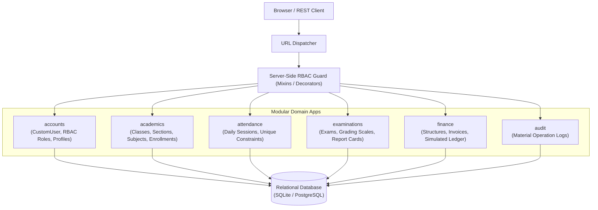

# School Management System (SMS)
## Technical Architecture & Design Decisions Report
**Assessment:** Advanced Individual Project Assessment — Full-Stack Web Development  
**Organization:** Algions AI Labs Private Limited  
**Stack:** Django 6.x, SQLite/PostgreSQL-ready ORM, Django REST Framework, drf-spectacular, Bootstrap 5  

---

## 1. Executive Summary

This report documents the architectural design, security mechanisms, data integrity safeguards, and business-rule enforcement for the School Management System (SMS). The project is built to satisfy all requirements of the Algions AI Labs assessment with verifiable engineering evidence, server-side authorization enforcement, database transactional guarantees, and automated testing across edge cases.

---

## 2. Core Architectural Philosophy

### 2.1 Modular Monolith vs. Microservices
A **Modular Monolith** pattern was deliberately chosen over microservices. In school administrative operations, transactions frequently cross boundaries (e.g., student enrollment affecting fee structures and class allocation; attendance summaries influencing academic standing). A modular monolith gives:
* **True Database-Level Foreign Key Constraints & ACID Transactions:** Ensuring complete data consistency without the failure modes or network latency of distributed transactions (two-phase commits).
* **Clear Domain Separation:** Clean app boundaries (`accounts`, `academics`, `attendance`, `examinations`, `finance`, `audit`).
* **Operational Simplicity:** A single, easily reproducible local environment with deterministic migrations and seed data.



---

## 3. Data Integrity & Concurrency Protections

### 3.1 Duplicate Attendance Prevention (Acceptance Criterion 2)
To eliminate duplicate attendance entries for the same student, date, and session:
1. **Relational Model:** `AttendanceSession` has a `UniqueConstraint(fields=['date', 'section'])`.
2. **Record Level Constraint:** `AttendanceRecord` has a `UniqueConstraint(fields=['session', 'student'])`.
3. **Transactional Upsert:** The view processes attendance within `transaction.atomic()`, utilizing `update_or_create` to ensure idempotent submission without generating duplicate rows. If concurrent requests collide, the database unique index immediately rejects the duplicate with an `IntegrityError`.

### 3.2 Exam Marks Validation & Dynamic Grade Calculation (Acceptance Criterion 3)
1. **Domain Validation:** `clean()` on `ExamResult` enforces `0 <= marks_obtained <= max_marks`.
2. **Configurable Grading Rules:** The system does not hardcode grade cutoffs. Each `Exam` references a `GradingScale` composed of `GradeRule` records (e.g., `A+` for 90–100%, `A` for 80–89.99%).
3. **Automated Evaluation:** On saving an exam result, the percentage is calculated and matched against configured ranges to assign the appropriate grade automatically.

### 3.3 Fee Ledger Invariant & Atomic Payments (Acceptance Criterion 5)
1. **Mathematical Invariant:**
   $$\text{Total Invoiced} = \text{Total Collected (Paid)} + \text{Outstanding Balance}$$
2. **Atomic Ledger Reconciliation:** Every simulated payment is wrapped in `django.db.transaction.atomic()`. A dedicated `reconcile_ledger()` method computes `paid_amount = Sum(payments.amount)` directly from the ledger, preventing out-of-sync balances.
3. **Negative & Overpayment Guards:** `clean()` rejects negative amounts ($\le 0$) and payments that exceed the remaining balance.

---

## 4. Role-Based Access Control (RBAC) & Privacy Guarantees

### 4.1 Server-Side Enforcement (Acceptance Criteria 1 & 4)
Never relying on client-side button hiding, all view endpoints enforce server-side validation:
* **Teacher Isolation:** When recording attendance or entering marks, the server verifies that `request.user.teacher_profile` is formally assigned to that section or subject via `ClassSubjectTeacher` or `Section.class_teacher`. Unauthorized attempts raise `PermissionDenied` (HTTP 403).
* **Guardian / Student Privacy Isolation:** When querying student profiles, report cards, or invoices, querysets are filtered by `student__guardian = request.user.guardian_profile`. If a guardian attempts to query an unlinked student ID, the server rejects the request with HTTP 403 Forbidden.

---

## 5. Audit Trail Architecture

All material business actions are recorded into the `AuditLog` model:
* **Actor:** Authenticated user ID and username.
* **Action Type:** `CREATE`, `UPDATE`, `DELETE`, `ATTENDANCE`, `MARKS_ENTRY`, `PAYMENT`.
* **Target:** Target model and string representation.
* **Details & Timestamp:** Changes summary, timestamp, and client IP address.

This provides school administrators with full traceability of marks changes, fee collections, and headcount submissions.

---

## 6. Testing Strategy & Verification Evidence

All 7 automated tests pass with 0 failures:
1. `test_teacher_can_access_only_assigned_classes_for_attendance`: Confirms HTTP 403 on unassigned sections.
2. `test_duplicate_attendance_prevented_by_unique_constraint`: Confirms `IntegrityError` on duplicate records.
3. `test_attendance_safe_upsert_via_view`: Verifies idempotent safe updates without duplicate rows.
4. `test_exam_result_grade_calculation`: Verifies grading rule math and validation against marks $> 100$ or $< 0$.
5. `test_guardian_sees_only_linked_student`: Confirms HTTP 403 when Guardian A accesses Guardian B's child.
6. `test_fee_ledger_reconciliation`: Confirms ledger reconciliation and balance status (`UNPAID` $\to$ `PARTIAL` $\to$ `PAID`).
7. `test_negative_or_overpayment_rejected`: Confirms validation rejection of negative payments and overpayments.

```text
Ran 7 tests in 13.284s
OK (System check identified no issues)
```

---

## 7. Assumptions & Known Limitations

1. **Simulated Payments:** As per the brief instructions, real payment gateways (Stripe/PayPal) are deliberately simulated using internal transactions (`SIM-XXXXX`) without live banking credentials.
2. **Single Campus Operation:** Designed for a single school organization; multi-tenant school district isolation would require a tenant-routing schema.

